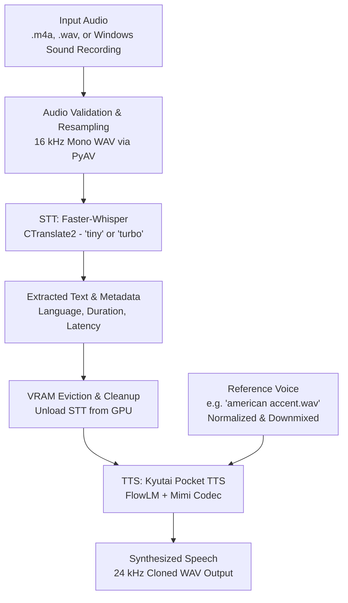

# Speech-to-Speech (S2S) Voice & Accent Conversion Pipeline

An end-to-end speech transformation system that takes spoken audio (e.g. Windows Voice Recorder `.m4a` files), transcribes it with **Faster-Whisper (STT)**, and re-synthesizes it in a target speaker's voice using **Kyutai Pocket TTS (TTS)**.

---

## 1. System Architecture

The pipeline converts speech while isolating GPU memory to run smoothly within a 6 GB VRAM budget (tested on NVIDIA RTX 3050 Laptop GPU / AMD Ryzen 7 7840HS):



### Architectural Highlights

1. **Strict VRAM Isolation**:
   - Whisper and Pocket TTS do not compete for GPU memory simultaneously.
   - Whisper loads, transcribes the audio, and is immediately evicted (`stt_adapter.unload()` + CUDA cache flush) before Pocket TTS loads.
2. **Robust Audio Conditioning**:
   - Reference voice inputs are automatically validated, downmixed from stereo to mono, and peak-normalized before Mimi neural latent encoding.
3. **Low Latency & High RTF**:
   - Uses CTranslate2 quantized inference for STT (`int8` on CPU, `float16` on CUDA).
   - Pocket TTS utilizes FlowLM autoregressive generation with Lagrangian Self Distillation (LSD) decoding.

---

## 2. End-to-End Workflow Pipeline

The unified pipeline (`pipeline.py`) executes across four automated stages:

```
[Stage 1: Ingestion] ────► [Stage 2: Format Conversion] ────► [Stage 3: STT] ────► [Stage 4: TTS Clone]
Auto-scans recordings      Decodes M4A / MP3 to 16kHz mono    Faster-Whisper       Pocket TTS (FlowLM+Mimi)
or explicit file input     WAV for Whisper ingestion          transcribes speech   synthesizes target voice
```

### Stage 1: Audio Resolution & Ingestion
- **Explicit path**: Pass any file via `--audio <path>`.
- **Automatic detection**: If omitted, scans Windows Sound Recordings (`C:\Users\<user>\Documents\Sound Recordings`) and selects the newest recording.
- **Interactive menu**: Pass `--select` to display an interactive list of recent recordings with timestamps and file sizes.
- **Fallback**: Uses `Testinput/Anoop voice line.wav` if no recordings exist.

### Stage 2: Audio Conversion & Resampling
- Any compressed format (`.m4a`, `.mp3`, `.aac`, etc.) is converted to 16 kHz mono 16-bit PCM WAV using PyAV.
- Skips re-encoding if the input is already a compliant WAV file.

### Stage 3: Speech-to-Text (STT) Transcription
- Transcribes speech using **Faster-Whisper**.
- Model options:
  - `tiny` (~75 MB, default): Near-instant transcription.
  - `turbo` (~1.6 GB): High precision for accented or complex audio.
- Detects language, calculates Real-Time Factor (RTF), and evicts the model from memory.

### Stage 4: Voice Cloning & Text-to-Speech (TTS)
- Loads **Kyutai Pocket TTS** (FlowLM model + Mimi 24 kHz neural audio codec).
- Reads target voice reference (default: `Testinput/american accent.wav`).
- Generates 24 kHz speech clone and writes the output WAV with full latency benchmarks.

---

## 3. Folder Structure

```text
d:\tts-poc\
├── pipeline.py                      # Root launcher (auto-activates virtual environment)
├── test.py                          # Shortcut for testing Whisper STT directly
│
├── scripts/                         # Core execution logic & utilities
│   ├── pipeline.py                  # Main S2S pipeline implementation (Stages 1-4)
│   ├── utils/
│   │   └── audio_convert.py         # PyAV audio resampling (.m4a -> 16kHz WAV)
│   ├── stt/
│   │   └── transcribe.py            # Standalone Faster-Whisper CLI transcription
│   └── tts/
│       └── test.py                  # Standalone Pocket TTS voice generation CLI
│
├── models/                          # Modular model wrappers & adapters
│   └── stt/
│       └── faster_whisper/
│           └── adapter.py           # Faster-Whisper CTranslate2 lifecycle adapter
│
├── DNXS-Spokenword-Pocket-TTS-GPU/  # Pocket TTS GPU Engine (Kyutai Labs fork)
│   ├── pocket_tts/                  # Core package (FlowLM, Mimi codec, generation)
│   │   ├── data/
│   │   │   ├── audio.py             # Audio I/O (stereo-to-mono downmixing, normalization)
│   │   │   └── audio_utils.py       # Resampling utilities
│   │   ├── models/
│   │   │   ├── tts_model.py         # TTSModel lifecycle & streaming generation
│   │   │   └── flow_lm.py           # FlowLM transformer architecture
│   │   └── default_parameters.py   # Default temperatures, LSD steps, and thresholds
│   └── .venv/                       # Dedicated Python 3.12 virtual environment
│
├── weights/                         # Local model weights (Git-ignored)
│   └── stt/
│       └── faster-whisper-large-v3-turbo-ct2/  # Local CTranslate2 weights
│
├── Testinput/                       # Sample recordings & reference voices
│   ├── american accent.wav          # Default target reference voice
│   ├── Anoop voice line.wav         # Default fallback input voice
│   └── Swetabh Input.m4a            # Sample M4A recording
│
└── Output/                          # Destination for generated speech files
    ├── pipeline_output_<timestamp>.wav
    └── converted_<name>.wav
```

---

## 4. Quickstart & Usage

### 1. Run the Complete Pipeline (Default)
Grabs the newest Windows Voice Recording, transcribes with `tiny` Whisper, and clones with the American accent reference:
```powershell
python pipeline.py
```

### 2. Interactively Select a Recording
Browse and select from recordings in your Windows Sound Recordings folder:
```powershell
python pipeline.py --select
```

### 3. Run with Specific Input & Target Voice
```powershell
python pipeline.py --audio "Testinput\Anoop voice line.wav" --reference "Testinput\american accent.wav"
```

### 4. High-Accuracy Transcription with Whisper Turbo
```powershell
python pipeline.py --audio "Testinput\Swetabh Input.m4a" --stt-model turbo
```

### 5. Fine-Tune Output Voice Quality
Control LSD decoding steps (higher = sharper, more defined speech) and sampling temperature:
```powershell
python pipeline.py --audio "Testinput\Anoop voice line.wav" --lsd-steps 4 --temp 0.65
```

---

## 5. CLI Arguments Reference

| Argument | Flag | Default | Description |
| :--- | :--- | :--- | :--- |
| `--audio` | `-a` | Auto-detect | Path to input audio (`.m4a`, `.wav`, `.mp3`). |
| `--recordings-dir` | | Windows Recordings | Folder to monitor for new recordings. |
| `--select` | | `False` | Interactively select audio from `--recordings-dir`. |
| `--reference` | `-r` | `american accent.wav` | Target voice WAV for zero-shot voice cloning. |
| `--output` | `-o` | `Output/pipeline_output_<ts>.wav` | Destination path for output WAV. |
| `--stt-model` | | `tiny` | Faster-Whisper model (`tiny` or `turbo`). |
| `--device` | | `auto` | Inference device (`auto`, `cuda`, or `cpu`). |
| `--lsd-steps` | | `3` | LSD decoding steps (2-5). Higher improves clarity. |
| `--temp` | | `0.7` | Sampling temperature for FlowLM generation. |
